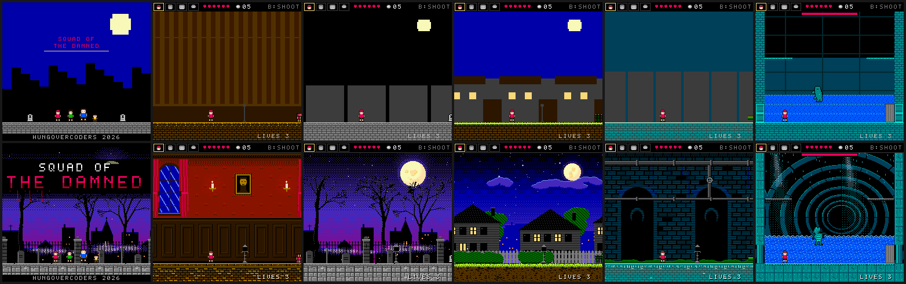

# Squad of the Damned

8-bit platformer. A squad of four kids versus the classic public-domain monsters, one night per monster, ending at a graveyard portal that has to be closed before midnight.

- **Stack:** Vite / TypeScript / Vitest, Canvas 2D (+ optional WebGL CRT pass), Web Audio, Tauri for desktop
- **Constraints:** 256×240 logical screen, 16px tiles, 4 colours per sprite, 2-button controls

## Play

```
npm install
npm run dev        # http://localhost:5173
```

| Action | Keyboard | Gamepad | Touch |
|---|---|---|---|
| Move | Arrows / WASD | D-pad / left stick | d-pad |
| Jump | Z / Space / K | A | A |
| Ability | X / J / Shift | X | B |
| Swap kid | C / L / Tab | B / RB | SW |
| Pause / menu | Enter / Esc / P | Start | ‖ |
| Fire silver | Up + ability (Casey) | | |
| Charged shot | hold ability (Casey) | | |
| Drop through platform | Down + jump | | |

Keys are remappable in Options. Dev keys: **F3** death heatmap, **F9** start/stop GIF recording.

## The squad

| Kid | Ability |
|---|---|
| **Casey** | Slingshot. Pebbles are infinite; silver shot is limited and the only thing that hurts the Wolfman. Hold to charge. |
| **Mo** | Garlic bombs on an arc; the cloud stuns everything in it. |
| **Bruno** | Pushes crates, punches through cracked walls, breaks the sluice gate. |
| **Pip** | Fits through vents, double jumps. |

The squad shares one HP pool. Swapping is instant with a freeze-frame and flash, and is refused if the new kid would not fit where you are standing.

## Art

Everything is drawn into a 256×240 buffer under NES rules: 16px tiles, every sprite at most 4 colours (transparent + 3) from a master palette of genuine 2C02 entries, no alpha blending.

- **Characters** (`src/game/art/kids.ts`, `monsters.ts`, `items.ts`): hand-placed pixels plus shape helpers, with rim lighting so dark silhouettes read on dark backgrounds.
- **Auto-tiles** (`src/game/art/autotiles.ts`): solid tiles pick a surface lip, corners and edge shading from their neighbours, plus one of four fill variants. Platforms, ladders, spikes, vents and water have per-theme versions.
- **Parallax backdrops** (`src/game/art/backdrops.ts`): dithered skies, a moon and halo, and 3–6 depth layers per theme, generated with the `PixelArt` helper (`src/engine/pixelart.ts`: Bayer dithering, shapes, outlines, seamless wrapping).
- **Effects without alpha**: checkerboard dither for flashes and lamplight, flicker for boss deaths, and an NES-style palette-step fade (`src/engine/fade.ts`) on scene changes and respawns.

`npm run check:palette` covers all ~1,500 generated and hand-drawn sprites.



## Knowledge as progression

Every boss has a weakness, but it only does damage once that monster's page of the **Monster Manual** has been found. Pages hide behind vents and cracked walls; field-note pages live in secret rooms. Read the manual from the pause menu.

## Scripts

| Command | What |
|---|---|
| `npm test` | Vitest: engine, squad rules, boss machine, save migration, palette constraint, level gating |
| `npm run typecheck` | `tsc --noEmit` |
| `npm run check:palette` | every sprite ≤ 4 colours from the NES master palette (#37) |
| `npm run check:colorblind` | sprite palettes stay distinguishable under protanopia / deuteranopia / tritanopia (#47) |
| `npm run export:levels` | string-row level sources → Tiled JSON in `src/game/levels/json` (CI checks it is up to date) |
| `npm run manual:pdf` | builds `docs/manual.pdf`, the retro manual matching the in-game bestiary |
| `npm run build` | production web build in `dist/` |
| `npm run tauri build` | desktop build (needs Rust and `@tauri-apps/cli`; see `src-tauri/`) |

## Layout

```
src/engine/   loop, input, tilemap, physics, sprites, camera, render, audio, save, particles, gif, font
src/game/     squad, player, projectiles, objects, enemies/, bosses/, manual, hud, music, scenes/, art/, levels/
scripts/      palette-check, colorblind-check, export-levels, manual-pdf
test/         vitest suites
docs/         design docs per night, playtest script, itch page copy, blog series outline, manual.pdf
src-tauri/    desktop shell
```

## Docs

- [Level design docs](docs/design/README.md) — beats, gimmick and required kids per night
- [Playtest script + telemetry](docs/playtest.md)
- [itch.io page copy](docs/itch.md)
- [Blog series outline + trailer GIF shot list](docs/blog/series.md)
